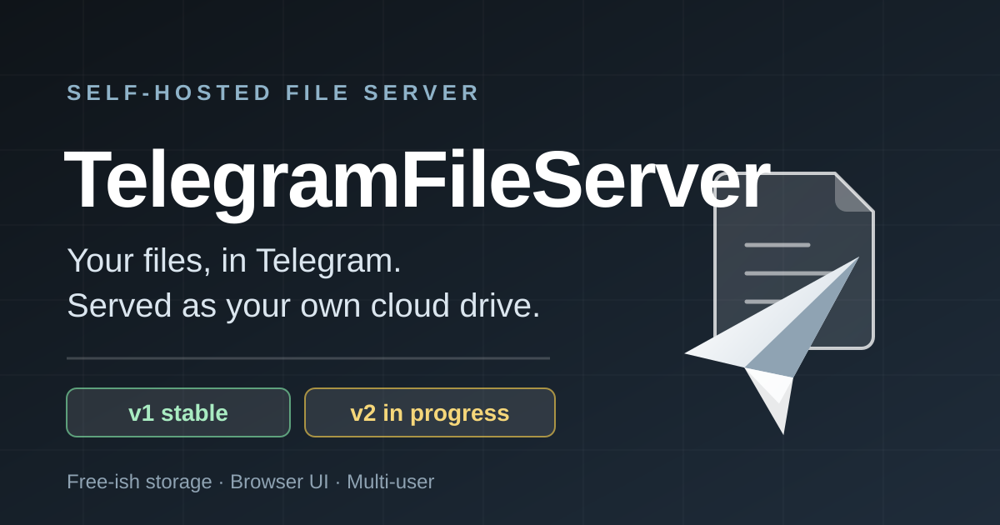
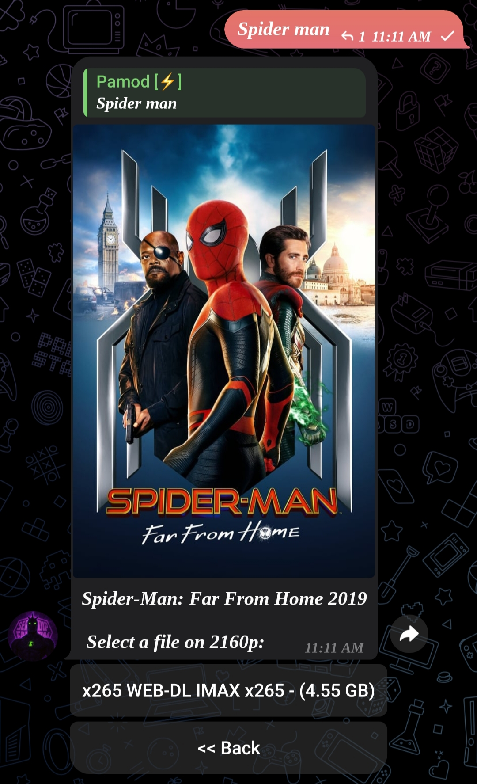
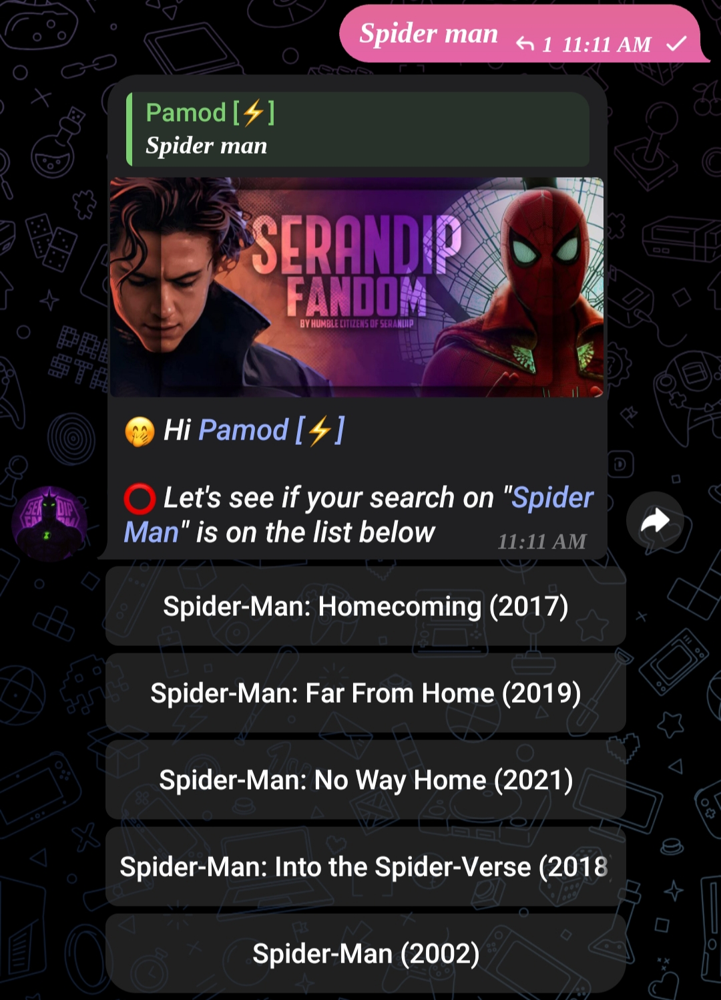
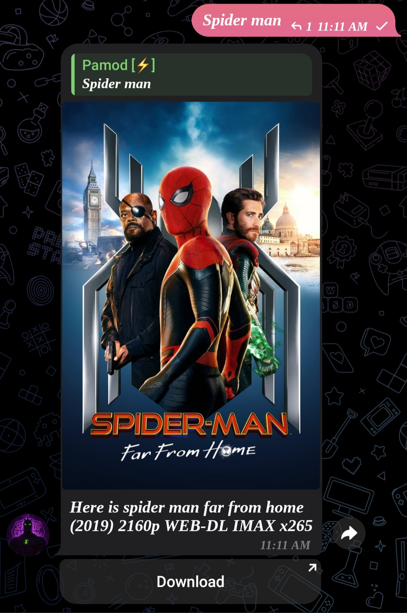

<!--
═══════════════════════════════════════════════════════════════════════════════
  SOCIAL PREVIEW CARD — assets/social-card.svg
═══════════════════════════════════════════════════════════════════════════════
  GitHub does NOT render raw inline SVG in a README, and a bare `.svg` upload is
  not accepted by Settings → Social preview (it wants a raster image). So the SVG
  in this repo is the *source*; export it to PNG once.

  STEP 1 — Export to a 1200×630 PNG (pick one):

    Option A — Inkscape (cross-platform, recommended)
      inkscape assets/social-card.svg \
              --export-type=png \
              --export-filename=social-card.png \
              --export-width=1200 --export-height=630

    Option B — Any browser
      Open assets/social-card.svg in Chrome/Firefox/Edge, then
      right-click → "Save image as…" → social-card.png (1200×630).

    Option C — resvg / svgtopng
      svgtopng assets/social-card.svg 1200 630 > social-card.png
      # or:  npx @resvg/resvg-js-cli assets/social-card.svg social-card.png

  STEP 2 — Upload it
      GitHub repo → Settings → General → Social preview → "Upload an image"
      (or drag social-card.png onto the repository's "About" sidebar).

  STEP 3 — Reuse the same 1200×630 PNG for
      Twitter/X cards, Reddit posts, LinkedIn, Mastodon, and Slack unfurls.
      Do not re-upload a differently-cropped version; keep one master file.

  Re-run this export whenever assets/social-card.svg changes.
═══════════════════════════════════════════════════════════════════════════════
-->

<p align="center">
  
</p>

<p align="center">
  <strong>Your files, in Telegram. Served as your own cloud drive.</strong><br>
  A self-hosted file server that keeps your data in Telegram and streams it back to you
  through a browser UI — free-ish storage, no third-party cloud account, multi-user.
</p>

<p align="center">
  <a href="LICENSE"></a>
  <a href="https://github.com/pamod-madubashana/TelegramFileServer/stargazers"></a>
  <a href="https://github.com/pamod-madubashana/TelegramFileServer/network/members"></a>
  
  
  <a href="https://github.com/pamod-madubashana/TelegramFileServer/pulls"></a>
</p>

> **Branch note.** `v1` is the stable Python release (formerly the default branch).
> **`v2` is the new default** and is a Rust rewrite, in progress. Everything
> under [Using v1 today](#quickstart) works right now; everything under
> [v2 in progress](#v2-in-progress) is honest status, not a promise.

---

## Purpose

TelegramFileServer stores your files in Telegram chats via bots and serves them back to
you as if they were your own cloud drive — because Telegram's per-chat storage is far
larger and cheaper than any mainstream cloud provider, and most people already have
that storage sitting there unused.

It exists to give that storage a real file-server interface: a browser UI, per-user
ownership, folders, search, resumable downloads, and direct links — instead of digging
through bot chat history by hand.

## Structure

```
TelegramFileServer/
├── apps/                      # Application shells (placeholder — v2)
│   ├── server/                # Planned HTTP/API server binary
│   └── desktop/               # Planned Tauri desktop app
├── crates/                    # Rust libraries (v2 workspace)
│   ├── telegram/              # ★ Working PoC — Telegram transfer engine (Grammers)
│   ├── api/                   # Planned API surface crate
│   ├── app-core/              # Planned shared domain logic
│   ├── db/                    # Planned persistence layer
│   ├── auth/                  # Planned authn/authz
│   ├── config/                # Planned configuration loading
│   └── jobs/                  # Planned background job runner
├── legacy/                    # ★ v1 — the stable Python/FastAPI release
│   ├── Dockerfile             # Container image for v1
│   ├── install.sh             # Linux service installer (tgserver ...)
│   ├── requirements.txt       # Python dependencies
│   └── .env.example           # Configuration template
├── tests/                     # Cross-crate integration tests (v2)
├── assets/
│   ├── social-card.svg        # 1200×630 social preview source
│   └── IMGS/README/           # Screenshots (Telegram bot chat captures)
├── ROADMAP.md                 # v2 plan
└── LICENSE                    # MIT
```

Only `crates/telegram` is a real crate today — the other `crates/*` and `apps/*`
directories are reserved placeholders.

## Features

### v1 — working today (`legacy/`)

- **Telegram as the storage backend** — files are uploaded to and downloaded from bot
  chats, so your data lives in Telegram's storage.
- **Resumable range streaming** — HTTP `206 Partial Content` with `Range` support, so
  large video and audio downloads resume instead of restarting.
- **Direct stream & watch routes** — `/dl/{file_name}` to download, `/watch/{file_name}`
  for inline playback, plus `/watch/{id}/{quality}` for a specific quality rendition.
- **Thumbnails** — `/files/thumbnail/{file_id}` for fast media previews.
- **Multi-user with roles** — per-file ownership, admin access via `require_admin`
  guards, and users only see their own files.
- **Telegram-verified login** — authenticate with your Telegram account.
- **Google OAuth** — optional Google sign-in for allowed admin emails.
- **Folders & search** — create folders, browse a hierarchy, and search across files.
- **Multi-bot workloads** — several bot tokens, with `/system/bots/info` and
  `/system/bots/workloads` to spread work across them.
- **Auto-update webhook** — `POST /system/github` triggers a deployment update.
- **Interactive API docs** — FastAPI's Swagger UI is served at `/docs`.

### v2 — in progress

See [v2 in progress](#v2-in-progress).

## Getting Started

Two paths, depending on what you want to run.

```bash
git clone https://github.com/pamod-madubashana/TelegramFileServer.git
cd TelegramFileServer
git checkout v1        # stable Python release — for actually serving files today
# git checkout v2      # Rust rewrite — read-only for now, build it instead
```

- **Want a working file server?** Follow [Quickstart → v1](#quickstart).
- **Want to work on the Rust rewrite?** Follow [Quickstart → v2](#quickstart).

## Prerequisites

### For v1 (running the server)

| Requirement | Notes |
|---|---|
| Python | `UNVERIFIED` — the previous README claimed 3.12+; verify against `legacy/requirements.txt` |
| MongoDB | Required — stores file metadata and ownership |
| Telegram `API_ID` / `API_HASH` | From [my.telegram.org](https://my.telegram.org) |
| Telegram bot token(s) | From [@BotFather](https://t.me/BotFather); multiple tokens are supported |
| Docker *(optional)* | Only if you prefer `legacy/Dockerfile` over a local Python env |
| A browser | For the web UI |

### For v2 (building the Rust crate)

| Requirement | Notes |
|---|---|
| Rust toolchain + Cargo | Minimum version `UNVERIFIED` — check `rust-toolchain.toml` if present |
| Telegram credentials | Needed only once live scenarios are executed |
| `clippy` + `rustfmt` | Both currently pass clean on `crates/telegram` |

## Installation

### v1 — local Python environment

1. **Create and activate a virtual environment**

   ```bash
   cd legacy
   python -m venv .venv
   # Linux / macOS
   source .venv/bin/activate
   # Windows PowerShell
   .\.venv\Scripts\Activate.ps1
   ```

2. **Install dependencies**

   ```bash
   pip install -r requirements.txt
   ```

3. **Create your config**

   ```bash
   # Linux / macOS
   cp .env.example .env
   # Windows PowerShell
   Copy-Item .env.example .env
   ```

   Then edit `.env` and fill in `API_ID`, `API_HASH`, a bot token, and `DATABASE_URL`.
   See [Configuration](#configuration).

4. **Run it**

   ```bash
   python __main__.py
   ```

   The server listens on port **8000** by default. Open `http://localhost:8000`.

> ⚠️ **Before you expose this to anyone:** `legacy/_data.py` ships with hardcoded
> fallback Google OAuth credentials. They are committed to the repository and are
> therefore public — replace them with your own values in `.env`, and never treat
> them as a secret. See [Security note](#security-note-before-deploying).

### v1 — Docker

```bash
cd legacy
docker build -t telegram-file-server .
docker run -p 8000:8000 telegram-file-server
```

### v1 — Linux service install

```bash
cd legacy
chmod +x install.sh
./install.sh
```

This registers a systemd service you drive with the [`tgserver`](#shortcuts) commands.

## Development

### v1

Everything for v1 lives in `legacy/`. Install in editable mode so your changes take
effect without reinstalling:

```bash
cd legacy
pip install -r requirements.txt
```

The entry point is `__main__.py`; reload on change with whatever reloader you prefer:

```bash
uvicorn --reload main:app --port 8000
```

`UNVERIFIED` — `main:app` and the reloader flags were not re-confirmed against
`legacy/` in this pass; run `python __main__.py` if they do not resolve.

### v2

The v2 workspace is a Cargo workspace. Today it declares exactly one member:

```toml
# Cargo.toml
[workspace]
members = ["crates/telegram"]
```

Day-to-day loop for the crate that exists:

```bash
cargo build --workspace
cargo test --workspace
cargo clippy --workspace
cargo fmt --all
```

Current state, verified: **7 tests green, clippy clean, fmt clean, release build clean.**

To pick up a new crate, add it to the `members` list and create the directory —
`apps/server` and `apps/desktop` are reserved for exactly that.

## Building

| Goal | Command | Artifact |
|---|---|---|
| Build v2 workspace | `cargo build --workspace` | `target/debug/` |
| Optimized v2 build | `cargo build --workspace --release` | `target/release/` |
| Build v1 container | `docker build -t telegram-file-server legacy` | Docker image `telegram-file-server` |
| Build v1 frontend | see [FileServerApp](https://github.com/pamod-madubashana/FileServerApp) | its own build pipeline |
| Build the desktop app | Tauri build from the `FileServerApp` repo | `UNVERIFIED` — command not re-confirmed |

## Usage

### Web UI

Start the server and open `http://localhost:8000` (or your `PORT`). Log in with
Telegram or Google OAuth, then browse folders, search, upload, preview, and share
direct links.

### Direct links

Once a file exists, you can hand out or embed these:

| Route | Purpose |
|---|---|
| `/dl/{file_name}` | Force download |
| `/watch/{file_name}` | Inline playback in the browser |
| `/watch/{id}/{quality}` | Play a specific quality rendition |
| `/files/thumbnail/{file_id}` | Thumbnail image |

Resumable downloads come for free through HTTP `206` range support — curl, browsers,
and download managers all handle them.

```bash
# Resumable download — interrupt and re-run to continue
curl -C - -o video.mp4 http://localhost:8000/dl/video.mp4
```

### System & API routes

| Route | Purpose |
|---|---|
| `/system/bots/info` | Which bot tokens are loaded |
| `/system/bots/workloads` | Work distribution across bots |
| `POST /system/github` | GitHub webhook to trigger auto-update |
| `/docs` | Interactive OpenAPI / Swagger documentation |

### Telegram bot chat

The bots themselves are usable from Telegram chat — these screenshots are captures of
that chat surface, not the web UI:

| | |
|---|---|
|  | Sending a file to the bot chat |
|  | Searching stored files from the bot chat |
|  | Downloading a file from the bot chat |

Other captures: `getfiles.jpg` (listing stored files), `filterPreview.jpg` (filter
previews), `resolution.jpg` (quality/resolution options).

## Shortcuts

The `legacy/install.sh` helper installs a service manager:

| Command | Does |
|---|---|
| `tgserver start` | Start the service |
| `tgserver stop` | Stop the service |
| `tgserver restart` | Restart the service |
| `tgserver status` | Report service status |
| `tgserver logs` | Follow live logs |
| `tgserver help` | Show usage |

v2 Rust shortcuts, straight from the standard toolchain:

| Command | Does |
|---|---|
| `cargo build --workspace` | Build every member (one crate today) |
| `cargo test --workspace` | Run all tests |
| `cargo clippy --workspace` | Lint |
| `cargo fmt --all` | Format |

## Configuration

All v1 configuration is environment-driven. Start from `legacy/.env.example`:

```bash
cp legacy/.env.example legacy/.env
```

| Variable | Description | Required |
|---|---|---|
| `API_ID` | Telegram API ID from my.telegram.org | Yes |
| `API_HASH` | Telegram API hash | Yes |
| `TOKEN0` | Primary bot token | Yes |
| `TOKEN1` … `TOKEN5` | Additional bot tokens | No |
| `DATABASE_URL` | MongoDB connection string | Yes |
| `OWNER` | Owner user ID | No |
| `PORT` | Web server port (default `8000`) | No |
| `GOOGLE_CLIENT_ID` | Google OAuth client ID | No |
| `GOOGLE_CLIENT_SECRET` | Google OAuth client secret | No |
| `AUTHORIZED_ADMIN_EMAILS` | Emails allowed to sign in as admins | No |

**Multiple bots.** The code scans a fixed range of **six** token slots, so `TOKEN0`
through `TOKEN5` are the supported set. `legacy/.env.example` ships a subset
(`TOKEN1`–`TOKEN3`); anything outside the scanned range is ignored.

### Security note before deploying

`legacy/_data.py` contains **hardcoded fallback credentials** that are checked when the
environment is incomplete. Because they live in the repository, they are public — treat
them as burned. Populate real values in `.env`, keep `.env` out of version control, and
rotate anything you care about.

## Troubleshooting

| Symptom | Likely cause and fix |
|---|---|
| Server starts but the UI is empty | `DATABASE_URL` is wrong or MongoDB is unreachable. Verify the connection string and that MongoDB is running. |
| Bot does not respond | Bad `API_ID`/`API_HASH`/token pair, or the bot was never told your user ID. Re-check credentials against my.telegram.org and @BotFather. |
| Only some uploads land on a bot | Expected — work is spread across the loaded tokens. Inspect `/system/bots/workloads`. |
| Extra bot tokens are ignored | Tokens outside `TOKEN0`–`TOKEN5` are never scanned. Rename them into that range. |
| Port already in use | Set a different `PORT` in `.env`. Default is `8000`. |
| Large download restarts instead of resuming | The client is not sending `Range`. Use `curl -C -` or a download manager that supports resume. |
| OAuth fails with a confusing error | The hardcoded fallback credentials in `legacy/_data.py` are being used. Set real `GOOGLE_CLIENT_ID` / `GOOGLE_CLIENT_SECRET`. |
| v2 builds, but nothing transfers | Expected today. The v2 engine is unit-tested offline; **live Telegram scenarios have not been run yet** — see [POC results](crates/telegram/POC_RESULTS.md). |

## Architecture

### v1 (Python)

```
Browser / Telegram client
        │
        ▼
  FastAPI app  ──►  stream_routes.py   (206 Range streaming, thumbnails)
        │        ├─► auth              (Telegram login, Google OAuth, roles)
        │        └─► /system           (bot info, workloads, GitHub webhook)
        │
        ├──► MongoDB                (file metadata, ownership, folders)
        │
        └──► Telegram bots          (Pyrogram / PyroFork, multiple tokens)
                  │
                  ▼
             Telegram storage      ← your actual files live here
```

The web layer and the bot layer both talk to Telegram, but in opposite directions:
uploads travel Telegram → bot → MongoDB metadata → storage, and downloads replay
Telegram → stream route → browser. Metadata (name, size, owner, folder) always stays
in MongoDB; bytes stay in Telegram.

### v2 (Rust, in progress)

```
  apps/server ─┐
  apps/desktop ┼──► crates/api ──► crates/app-core ──► crates/{db,auth,jobs,config}
               │
               └──► crates/telegram   ← implemented today
```

`crates/telegram` is the foundation: a `TelegramClient` trait hiding a Grammers-based
transfer engine that covers upload, download, ranged streaming, cancellation, and
FloodWait retry. Everything above it is intended to be written against that trait,
so swapping the transport or the app shell does not ripple upward.

Rewriting in Rust targets fewer copies of every file, bounded concurrency, and far
better retry behaviour than the Python bot session can offer — plus a Tauri desktop
app alongside the server.

## Tech Stack

| Technology | Role | Version |
|---|---|---|
|  | v2 workspace language | `UNVERIFIED` |
|  | v2 Telegram MTProto engine | **0.10** |
|  | v1 backend language | `UNVERIFIED` |
|  | v1 HTTP API + OpenAPI docs | `UNVERIFIED` |
|  | v1 Telegram client | `UNVERIFIED` |
|  | Metadata & ownership store | `UNVERIFIED` |
|  | Web UI (separate repo) | `UNVERIFIED` |
|  | Web UI language | `UNVERIFIED` |
|  | Web UI styling | `UNVERIFIED` |
|  | Web UI build tool | `UNVERIFIED` |
|  | Desktop app shell | `UNVERIFIED` |
|  | v1 packaging | `UNVERIFIED` |

`UNVERIFIED` = not pinned to a specific version in a manifest re-confirmed for this
README; check `legacy/requirements.txt` and the `Cargo.toml` files for exact numbers.

> **No CI.** This repository has no GitHub Actions workflow, so there is deliberately
> **no build/test badge** in this README. Verify locally with the commands above.

## Downloads

### v1 (from source — not on PyPI)

TelegramFileServer is not published to PyPI or any package registry. Install it from a
clone:

```bash
git clone https://github.com/pamod-madubashana/TelegramFileServer.git
cd TelegramFileServer/legacy
pip install -r requirements.txt
python __main__.py
```

Or build the image yourself:

```bash
docker build -t telegram-file-server legacy
```

### v2 (from source — no releases yet)

No v2 artifacts are published. Build locally:

```bash
cargo build --workspace --release
```

### Desktop app

Desktop builds (Windows, Linux, macOS) are produced by the separate
[FileServerApp](https://github.com/pamod-madubashana/FileServerApp) repository.

- [FileServerApp releases](https://github.com/pamod-madubashana/FileServerApp/releases) — `UNVERIFIED`: direct asset filenames from the previous README were not re-confirmed and may be stale. Download from the releases page rather than a hardcoded asset URL.

## v2 in progress

The rewrite is underway on the `v2` branch, which is becoming the default branch as
`v1` retires.

### Goals

- **Fewer copies of your data** — single-pass transfers instead of the
  download-reupload dance the Python bot path can require.
- **Bounded concurrency** — explicit queues and limits instead of unbounded task
  spawning.
- **Better retries** — proper FloodWait handling and resumable transfers.
- **Desktop app** — Tauri shell alongside the server (`apps/desktop`).

### Honest status

| Piece | State |
|---|---|
| `crates/telegram` transfer engine (Grammers behind a `TelegramClient` trait) | ✅ Written |
| Upload / download / ranged streaming / cancellation / FloodWait retry | ✅ Implemented |
| Offline unit tests | ✅ 7 passing |
| `cargo clippy` | ✅ Clean |
| `cargo fmt` | ✅ Clean |
| `cargo build --release` | ✅ Clean |
| Live Telegram scenarios | ⏳ **Not yet run — all `NOT RUN`** |
| `apps/server`, `apps/desktop`, remaining `crates/*` | ⏳ Placeholders |

Read it as: **the engine and its test harness are ready; the live Telegram run is
pending.** Do not expect to move real files with v2 yet.

### Where to look

- [`crates/telegram/README.md`](crates/telegram/README.md) — the engine's own docs.
- [`ROADMAP.md`](ROADMAP.md) — what v2 plans to become.
- [`crates/telegram/POC_RESULTS.md`](crates/telegram/POC_RESULTS.md) — the live-scenario
  checklist and its current `NOT RUN` state.

## Frontend

The web UI and desktop app are maintained separately:

- **Repository:** [FileServerApp](https://github.com/pamod-madubashana/FileServerApp)

It was previously wired in as a git submodule, but the submodule reference has since
been removed. To attach it again:

```bash
git submodule add https://github.com/pamod-madubashana/FileServerApp <target-path>
```

`<target-path>` is your call — the old `src/frontend` path no longer applies on this
branch.

## Links

| Resource | Link |
|---|---|
| Repository | [github.com/pamod-madubashana/TelegramFileServer](https://github.com/pamod-madubashana/TelegramFileServer) |
| v1 (stable) branch | [branch/v1](https://github.com/pamod-madubashana/TelegramFileServer/tree/v1) |
| v2 (rewrite) branch | [branch/v2](https://github.com/pamod-madubashana/TelegramFileServer/tree/v2) |
| Frontend & desktop app | [FileServerApp](https://github.com/pamod-madubashana/FileServerApp) |
| Issue tracker | [Issues](https://github.com/pamod-madubashana/TelegramFileServer/issues) |
| Pull requests | [Pull requests](https://github.com/pamod-madubashana/TelegramFileServer/pulls) |
| Open a pull request | [New pull request](https://github.com/pamod-madubashana/TelegramFileServer/compare) |
| Open an issue | [New issue](https://github.com/pamod-madubashana/TelegramFileServer/issues/new) |
| License | [LICENSE](LICENSE) |
| Roadmap | [ROADMAP.md](ROADMAP.md) |
| v2 engine docs | [crates/telegram/README.md](crates/telegram/README.md) |
| v2 POC results | [crates/telegram/POC_RESULTS.md](crates/telegram/POC_RESULTS.md) |
| Social card source | [assets/social-card.svg](assets/social-card.svg) |
| Telegram API credentials | [my.telegram.org](https://my.telegram.org) |
| Bot token creation | [@BotFather](https://t.me/BotFather) |

There is no `CONTRIBUTING.md`, no `CODE_OF_CONDUCT.md`, and no Discussions board in this
repository — the contributing flow below and the issue tracker are the channels.

## Credits

- **Pamod Madubashana** — sole author and maintainer of TelegramFileServer and
  FileServerApp.
- **[Grammers](https://github.com/puregrammers/grammers)** — the MTProto client powering
  the v2 engine.
- **[Pyrogram](https://github.com/pyrogram/pyrogram)** and
  **[PyroFork](https://github.com/pyrofork/pyrogram)** — the Telegram clients behind v1.
- **[FastAPI](https://fastapi.tiangolo.com/)** and
  **[MongoDB](https://www.mongodb.com/)** — v1's web and data layers.
- Everyone who opened an issue, tried it on a Raspberry Pi, or sent a PR.

## Contributing

PRs are welcome, especially on `v2`.

1. Fork the repository.
2. Branch off `v2` for Rust work, or `v1` for Python fixes.
3. Make your change — one concern per commit, imperative message, explain *why*.
4. Verify locally: `cargo test --workspace`, `cargo clippy --workspace`, `cargo fmt --all`
   for v2; for v1, start the server and click through the affected flow.
5. Open a pull request describing what changed and how you tested it.

Please never commit `.env`, bot tokens, API hashes, or database URIs.

## License

**MIT** — Copyright (c) 2025 P A M O D.

Full text: [LICENSE](LICENSE).

---

## Final Quality Check

- [x] Hero is a centered `` pointing at `assets/social-card.svg` (no inline SVG)
- [x] Social-card export instructions present in a top HTML comment block
- [x] One-line pitch directly under the hero
- [x] Badges: license, stars, forks, `v1 stable`, `v2 in progress`, `PRs welcome`
- [x] **No CI badge** — this repository has no CI workflow
- [x] Screenshots captioned as Telegram bot chat captures, not web UI shots
- [x] Features list only claims what v1 verifiably does
- [x] v2 status is honest: engine + tests ready, live scenarios `NOT RUN`
- [x] All v1 paths are prefixed with `legacy/` (no stale root `requirements.txt`,
      `Dockerfile`, `install.sh`, or `src/` references)
- [x] `cargo build --workspace` documented, with the "one crate today" caveat
- [x] Configuration table lists only variables present in `legacy/.env.example`
- [x] Hardcoded credential warning included; **no secret values reproduced**
- [x] Desktop download links flagged `UNVERIFIED` rather than stated as fact
- [x] Unknown versions marked `UNVERIFIED` instead of invented
- [x] Repo layout matches the actual `apps/`, `crates/`, `legacy/`, `tests/`, `assets/` tree
- [x] Frontend points at the FileServerApp repo and notes the submodule is gone
- [x] Credits limited to real, verifiable contributors and upstream projects
- [x] License matches the actual `LICENSE` file (MIT, © 2025 P A M O D)
- [x] Link text is descriptive — no "click here"
